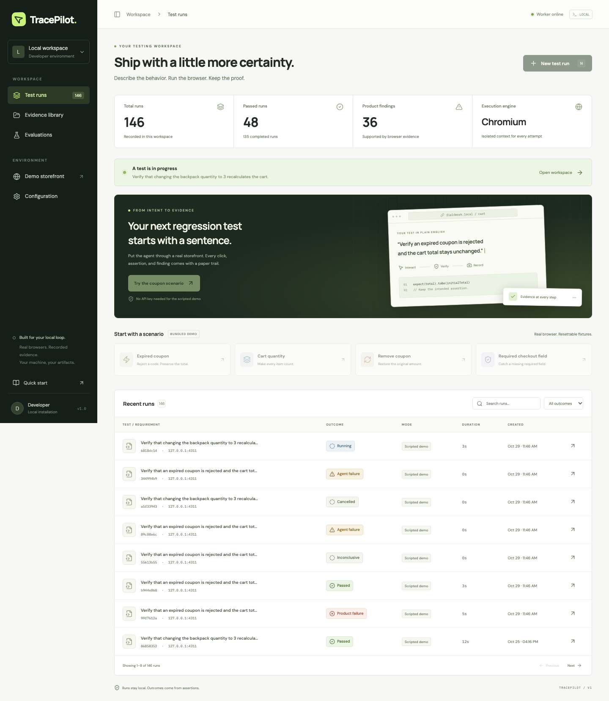
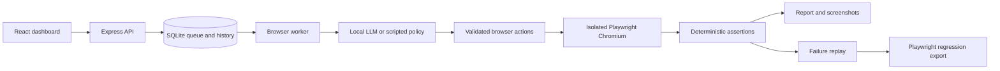

# TracePilot

**AI-assisted browser testing, with proof.**

TracePilot turns a testing goal and explicit expectations into a recorded browser session. A local language model chooses actions, Playwright executes them, and deterministic assertions decide the outcome. Every run includes an execution timeline, screenshots, diagnostics, and a report. Supported failures can be replayed in a clean session and exported as Playwright regression tests.

[](https://github.com/Sandeep1519-droid/tracepilot/actions/workflows/ci.yml)

**TypeScript · React · Node.js · Express · Playwright · SQLite · Ollama**



## What it does

- **AI-guided execution:** local Ollama inference selects schema-validated browser actions using observed page controls.
- **Evidence-backed results:** explicit assertions distinguish a product failure from an execution failure or an inconclusive run.
- **Failure reproduction:** replay the recorded interactions and original checks in a clean browser session.
- **Regression export:** generate a Playwright test; bundled-demo exports are validated against both correct and intentionally broken fixtures.
- **Persistent run history:** SQLite job queue, cancellation, worker recovery, screenshots, traces, and downloadable reports.
- **External page checks:** configure target origins and assert visibility, text, or field values through the UI.
- **Free scripted demo:** deterministic ecommerce scenarios exercise the same browser and reporting infrastructure without an AI model or API key.

## Quick start

Requirements: **Node.js 20.19+ (22 recommended)**, npm, and the Playwright Chromium browser. SQLite is embedded. Native build tools may be required if `better-sqlite3` has no prebuilt binary for your platform.

```bash
git clone https://github.com/Sandeep1519-droid/tracepilot.git
cd tracepilot
npm ci
npx playwright install chromium
npm run dev
```

Open **[localhost:5173](http://127.0.0.1:5173)**. The command starts the frontend, API/demo server, and browser worker.

| Component | Address |
| --- | --- |
| React dashboard | `http://127.0.0.1:5173` |
| Express API | `http://127.0.0.1:4310` |
| Controlled demo store | `http://127.0.0.1:4311` |

For a production frontend build served locally:

```bash
npm run build
npm start
# Open http://127.0.0.1:4310
```

## Try it in two minutes

1. Open **New test run** and select **Expired coupon**.
2. Keep **Scripted demo · no API needed**.
3. Choose **Defect: expired coupon discounts total** and start the run.
4. Inspect the unchanged-total assertion: the broken fixture changes `$72.00` to `$59.20` despite rejecting the coupon.
5. Open the reproduction evidence and download the generated Playwright test.
6. Repeat with **Correct baseline**; the same assertions pass.

Other bundled scenarios cover cart quantities, coupon removal, required checkout fields, and a synthetic test-account login. These use isolated fixtures and never process real payments.

## Run with local AI

With [Ollama](https://ollama.com/) installed:

```bash
ollama pull qwen3:4b
ollama serve
# If Ollama is already running, keep the existing service.
```

Select **AI model** in TracePilot. The defaults use `qwen3:4b` at `http://127.0.0.1:11434`; no paid API key is required. Model quality and your hardware affect completion rates and latency.

To customize configuration:

```bash
cp .env.example .env.local
```

Edit `.env.local` and restart the services. Set `ALLOWED_ORIGINS` to exact external origins you intend to test. For external sites, choose **External website / custom checks** and supply explicit page assertions. Optional hosted-provider settings and credential references are documented in the [development guide](docs/DEVELOPMENT.md#configuration).

## How it works



The model proposes one action at a time. Trusted code validates it, resolves the currently observed element, executes it, and records evidence. Assertions retain the original expectations; a successful click alone cannot establish a pass. [Architecture details →](docs/ARCHITECTURE.md)

## Measured results

Recorded on a **13-case controlled benchmark** with local `qwen3:4b`:

| Measure | Result |
| --- | --- |
| AI verdict matches | 8 / 13 |
| Known defects detected | 3 / 5 |
| False bug reports on correct fixtures | 0 / 6 |
| Reported findings reproduced | 3 / 3 |
| Produced regression exports verified | 6 / 6 |
| Scripted infrastructure verdict matches | 13 / 13 |

Five AI cases stalled: coupon removal, checkout, and login. Scripted results are reported separately from AI results. These measurements do not establish general website reliability. [Full analysis](docs/AI-BENCHMARK.md) · [AI results](docs/benchmark-ai.json) · [Scripted results](docs/benchmark-scripted.json)

A separate Amazon India smoke attempt reached search submission but received HTTP 503 and was recorded as **inconclusive**. External access challenges are not counted as product failures. [Live-test summary](docs/AMAZON-TEST.md)

## Development and tests

```bash
npm test                  # schemas, outcomes, replay, concurrency, and security rules
npm run test:lifecycle    # isolated queue, cancellation, and worker recovery
npm run build             # TypeScript checks and frontend build
```

With `npm run dev` running in another terminal:

```bash
npm run test:integration  # browser/API/UI smoke checks; no model needed
npm run test:external     # controlled local external-page checks and UI form
npm run eval              # scripted benchmark
npm run eval:ai           # actual model benchmark; requires Ollama
```

`eval:ai` records all cases and exits nonzero if outcomes differ from the benchmark expectations. `test:evaluations` additionally checks the UI against locally generated AI and scripted benchmark reports; run both benchmarks first. CI runs tests, a build, and the browser integration suite without paid services.

## Project structure

```text
src/
  web/       React dashboard, run workspace, and evaluation ledger
  server/    API, worker, browser tools, verification, replay, and export
  shared/    Zod schemas and shared TypeScript types
scripts/     Integration tests, evaluations, replay, and smoke runners
tests/       Automated tests and benchmark definitions
docs/        Architecture, recorded benchmark results, and demo screenshots
```

## Scope and limitations

TracePilot is a **local, single-user application** with one worker and Chromium support. It requires explicit verification contracts and does not infer arbitrary business assertions from prose. External sites may reject isolated browser sessions; CAPTCHA and popup flows are unsupported. External and credential-bearing exports remain unverified without controlled baseline/defect fixtures.

The API binds to loopback and has no multi-user authentication. GitHub hosts this source repository; GitHub Pages cannot run its Node worker, SQLite database, or Chromium. A public hosted service would require additional authentication and browser isolation.

Secrets, local databases, traces, external-page captures, and unrelated workspace files are excluded from Git. Credential-bearing runs disable screenshots and traces. See the [development guide](docs/DEVELOPMENT.md) for configuration, security boundaries, and replay instructions.
