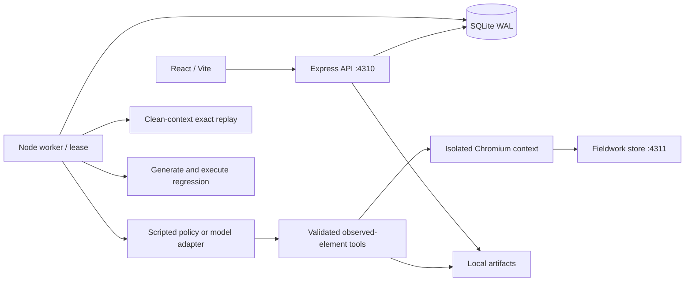

# Architecture

The API admits at most one queued/running job in a SQLite transaction. Store transactions that read before writing use immediate acquisition so concurrent heartbeats cannot invalidate a deferred WAL snapshot. A separate process claims jobs and owns browser and cancellation lifecycle. Web requests never hold long-running browser sessions. A single heartbeat lease prevents concurrent workers. Stale running jobs are marked interrupted on worker recovery.

`shared/domain.ts` defines schemas and the public run record. `verification.ts` compiles supported expectations into immutable checks. `browser.ts` collects bounded page observations and resolves observation-local references into trusted locators. `provider.ts` receives only an allowlisted prompt payload: no fixture variant, evaluator label, source or credentials. Browser observations are untrusted data. Scripts and AI decisions use the same executor.

Each meaningful action produces a timestamped event with redacted arguments, target, URL, timing, observation, screenshot and associated assertions. Deterministic arithmetic uses integer minor units. Reports derive findings from those records. Lifecycle is independent from verdict.

Suspected product failures trigger a clean fixture/session and exact recorded-action replay. Replay targets are matched by their original locator specification; if missing, replay is incomplete, with no business-action substitution. Both attempts are preserved. Each event records whether it was rejected before a browser operation started, succeeded, or failed after execution began. Replay and export may omit only proven pre-execution rejections, with explicit audit entries; uncertain or partially executed failures are retained.

Exports compile recorded first-attempt actions and original check specifications. A separate Playwright subprocess validates the exact generated file against fresh correct and broken fixtures. Subprocesses are bounded and aborted on cancellation. Verified status requires the baseline to pass and an assertion to fail on the broken fixture.

The API and demo are on separate origins. The fixture reset endpoint requires a server-side token. Browser routing blocks access to that endpoint. Opaque cookie fixture sessions separate concurrent external previews and each run attempt. Fixture maps are bounded and reset naturally on server restart.

Data lives under `DATA_DIR`: SQLite, permission-restricted local control material, and per-UUID artifacts. An artifact filename allowlist prevents arbitrary file access. Credential-reference runs deliberately disable traces/screenshots. API and UI remain a local, single-developer installation, without remote authentication or a hostile-website sandbox.
